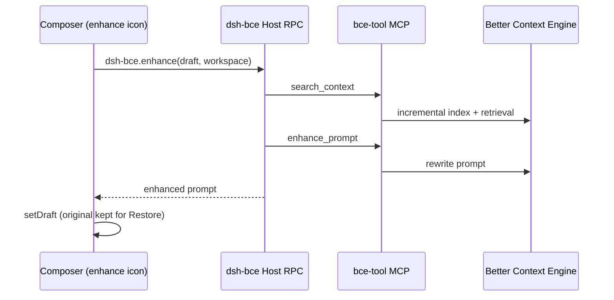

<div align="center">


# dsh-bce

**Context-aware prompt enhancement for the DeepSeek Harness composer, powered by your Better Context Engine MCP.**

[](https://www.npmjs.com/package/dsh-bce) [](#license) [](#requirements) [](https://github.com/deepseek-ai/deepseek-harness)

English · [简体中文](README.zh.md)

[Demo](#demo) · [Features](#features) · [How it works](#how-it-works) · [Installation](#installation) · [Usage](#usage) · [FAQ](#faq)

</div>

---

`dsh-bce` adds an enhance icon next to the composer's attach button. One click incrementally indexes the current workspace through the Better Context Engine (BCE) MCP server already configured in your profile, then rewrites the draft into a context-rich prompt.

> [!NOTE]
> The plugin stores no BCE base URL or token. Credentials stay on the MCP entry of the active profile and never reach the browser.

## Demo

<div align="center">
  
  <br />
  <sub>Played at 1.5× speed · <a href="docs/demo.mp4">Download MP4</a></sub>
</div>

## Features

- **One-click enhancement** – the icon sits on `conversation.input.left` (order `-40`), right next to the attach button.
- **Workspace-aware** – runs an incremental `search_context` before `enhance_prompt`, so the rewrite is grounded in your code.
- **Clear feedback** – disabled on an empty draft; while running it shows **Enhancing prompt…**, an animated edge ring, and locks further clicks.
- **Reversible** – **Restore original** brings back the pre-enhancement draft.
- **Zero extra config** – reuses the profile's bce-tool MCP; no plugin-side BCE settings form.
- **One bundle** – web and Desktop share the same client build.

## Overview

| Item | Value |
| :--- | :--- |
| Host | [DeepSeek Harness](https://github.com/deepseek-ai/deepseek-harness) (`web` / Desktop) |
| Engine | [Better Context Engine](https://github.com/linqiu919/better-context-engine) |
| MCP server | [bce-tool](https://github.com/linqiu919/bce-tool-rs) (`search_context`, `enhance_prompt`) |
| Client platform | `dsh.client.platform: web` (shared by web and Desktop) |
| Enhance timeout | 90 s (`ENHANCE_TIMEOUT_MS`) |
| Index timeout | MCP `toolCallTimeoutMs` |

## How it works



1. The client reads the composer draft and resolves the workspace path.
2. Host RPC `dsh-bce.enhance` locates `mcp__*__search_context` and `mcp__*__enhance_prompt`; servers whose name contains `bce` are preferred.
3. `search_context` performs incremental indexing and retrieval.
4. `enhance_prompt` rewrites the prompt, aborted after 90 s.
5. The enhanced text replaces the draft. **Restore original** writes back the previous prompt.

> [!IMPORTANT]
> bce-tool must be started with `--no-webbrowser-enhance-prompt`. Without it, `enhance_prompt` waits on a local review page and the request times out.

## Requirements

| Component | Constraint |
| :--- | :--- |
| Node.js | `^22.19` or `>=24` |
| DeepSeek Harness | web CLI or official Desktop |
| BCE | Reachable HTTP API and a valid token |
| bce-tool MCP | Same profile as the plugin, with `--no-webbrowser-enhance-prompt` |
| Workspace | Git repository, unless the MCP is started with `--allow-non-git` |

Web and Desktop profiles do not share MCP servers or plugin installs. Configure each one separately.

## Installation

### 1. Register the bce-tool MCP

Add the following to the target profile's `cordis.patch.yml`:

```yaml
- insert:
  - id: mcp-bce
    name: '@deepseek-ai/dsh-mcp-client'
    config:
      serverName: bce
      transport: stdio
      command: npx
      args:
        - -y
        - bce-tool
        - --base-url
        - 'https://your-bce-host'
        - --token
        - '***'
        - --allow-non-git
        - --no-webbrowser-enhance-prompt
      env:
        PATH: /usr/local/bin:/usr/bin
      toolCallTimeoutMs: 120000
      failOnStartupError: false
```

| Field | Notes |
| :--- | :--- |
| `serverName` | Any name. Discovery matches tool-name suffixes; names containing `bce` are preferred. |
| `command` | On Desktop / Electron, use an absolute `npx` path — the GUI `PATH` usually omits nvm. |
| `toolCallTimeoutMs` | Indexing budget, independent of the plugin's 90 s enhance abort. |

### 2. Install the plugin

Install the prebuilt package from npm. No local build is required.

```sh
# web
dsh plugin --profile web add dsh-bce

# official Desktop: launch once, quit completely, then run
dsh plugin --profile desktop add dsh-bce
```

If the packaged Desktop app boots the `web` profile under its own data directory, install into that profile instead.

To update later, run the same command with `dsh-bce@latest`.

### 3. Restart

Quit DeepSeek Harness completely and start it again.

> [!TIP]
> Host and client plugins load at process start. A soft reload of the window is not enough.

### Build from source (optional)

```sh
git clone https://github.com/linqiu919/dsh-bce.git
cd dsh-bce
pnpm install && pnpm build
dsh plugin --profile web add "$(pwd)"
```

## Usage

1. Open a workspace.
2. Type a non-empty prompt in the composer.
3. Click the enhance icon. The status reads **Enhancing prompt…**
4. When it finishes, the draft is replaced. Click **Restore original** to go back.

## FAQ

| Symptom | Cause | Resolution |
| :--- | :--- | :--- |
| BCE MCP was not found | `enhance_prompt` is not loaded in this profile | Add the MCP entry above with `--no-webbrowser-enhance-prompt`, then restart. Configure web and Desktop separately. |
| Open a workspace first | The session has no workspace root | Select a workspace and retry. |
| Enhancement is slow | Latency is tied directly to the enhancement model configured in the BCE engine: `enhance_prompt` is generated by that model, so duration depends on its inference speed, output length, and upstream load | Switch to a faster enhancement model in the BCE engine, or check the model service load. The plugin only calls the tool and writes back the result; it does not affect generation time. |
| Enhancement timed out (90 s) | Review page blocking, or a slow BCE enhancement model | Make sure `--no-webbrowser-enhance-prompt` is set; if it still times out, switch to a faster enhancement model in the BCE engine. Indexing is governed by `toolCallTimeoutMs`, not the 90 s cap. |
| Not a Git repository | bce-tool default | Add `--allow-non-git`. |
| Project too large to index | bce-tool size limit | Narrow the tree with `.gitignore` / `.bceignore`. |
| No response after an update | Stale process | Quit completely and reopen. |
| Cmd/Ctrl+Z does not revert | `setDraft` is outside the composer undo stack | Use **Restore original**. |
| Markdown is not rendered in the composer | The composer is a plain-text draft with file-reference chips | Keep enhancer output as plain text. |

**Why not call BCE from the browser?** The BCE service has no CORS layer, and the token must stay on the host. The enhance icon calls the host RPC, which executes the configured MCP tools.

## License

MIT
