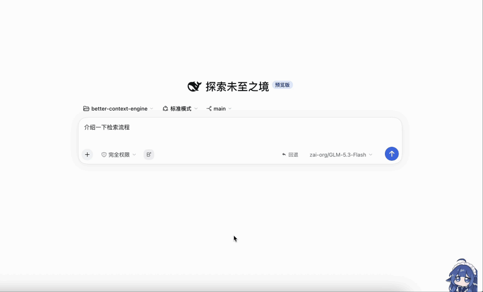
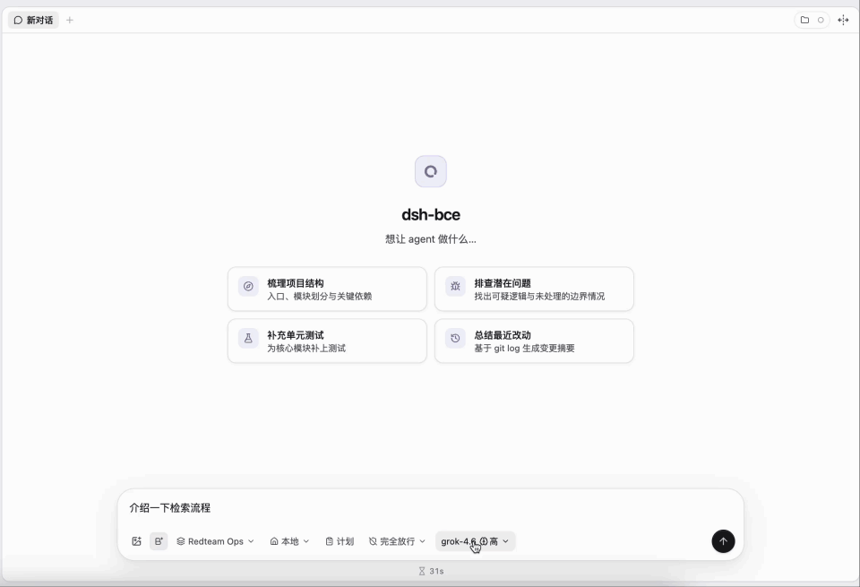
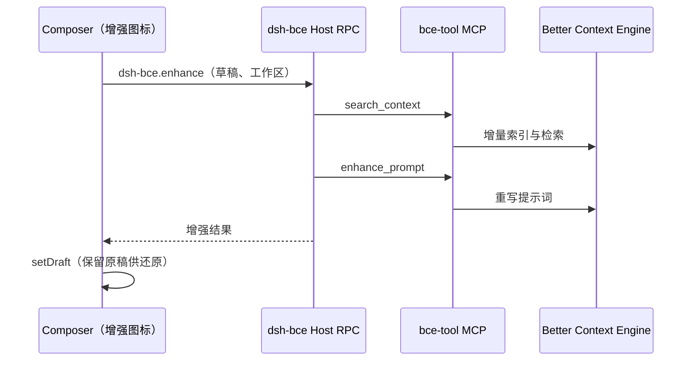

<div align="center">


# dsh-bce

**为 DeepSeek Harness Composer 提供基于工作区上下文的提示增强，复用你已配置的 Better Context Engine MCP。**

[](https://www.npmjs.com/package/dsh-bce) [](#许可) [](#环境要求) [](https://github.com/deepseek-ai/deepseek-harness) [](#环境要求)

[English](README.md) · 简体中文

<sub>友链 · <a href="https://github.com/J3n5en/EnsoCode"> EnsoCode</a></sub>

[演示](#演示) · [功能](#功能) · [工作原理](#工作原理) · [安装](#安装) · [EnsoCode](#ensocode) · [Paseo](#paseo) · [使用](#使用) · [常见问题](#常见问题)

</div>

---

`dsh-bce` 在 Composer 附件按钮旁增加一个增强图标。点击后，插件通过当前 profile 已配置的 Better Context Engine（BCE）MCP 对工作区做增量索引，再把草稿重写为带有上下文的提示词。

> [!NOTE]
> 插件不保存 BCE 服务地址或 Token。凭证只保存在当前 profile 的 MCP 配置中，仅由 Host 端的 bce-tool 使用，不会下发到前端界面（web 页面或 Desktop 窗口）。

## 演示

<div align="center">
  
  <br />
  <sub>DeepSeek Harness · 2 倍速播放 · <a href="docs/demo.mp4">下载 MP4</a></sub>
  <br />
  <br />
  
  <br />
  <sub>EnsoCode · 2 倍速播放 · <a href="docs/demo-enso.mp4">下载 MP4</a></sub>
</div>

## 功能

- **一键增强**：图标位于插槽 `conversation.input.left`（order `-40`），紧挨附件按钮。
- **感知工作区**：先增量 `search_context`，再 `enhance_prompt`，增强结果基于你的代码。
- **状态清晰**：草稿为空时禁用；进行中显示 **提示增强中**、边缘流动光环，并锁定重复点击。
- **可还原**：增强成功后可点 **还原** 恢复原稿。
- **零额外配置**：复用 profile 中的 bce-tool MCP，不提供插件内 BCE 配置页。
- **单一产物**：web 与 Desktop 共用同一客户端构建。

## 概览

| 项目 | 说明 |
| :--- | :--- |
| 宿主 | [DeepSeek Harness](https://github.com/deepseek-ai/deepseek-harness)（`web` / Desktop） |
| 引擎 | [Better Context Engine](https://github.com/linqiu919/better-context-engine) |
| MCP 服务 | [bce-tool](https://github.com/linqiu919/bce-tool-rs)（`search_context`、`enhance_prompt`） |
| 客户端平台 | `dsh.client.platform: web`（web 与 Desktop 共用） |
| 增强超时 | 90 秒（`ENHANCE_TIMEOUT_MS`） |
| 索引超时 | MCP `toolCallTimeoutMs` |

## 工作原理



1. 客户端读取 Composer 草稿并解析工作区路径。
2. Host RPC `dsh-bce.enhance` 发现 `mcp__*__search_context` 与 `mcp__*__enhance_prompt`，优先使用名称含 `bce` 的服务。
3. `search_context` 执行增量索引与检索。
4. `enhance_prompt` 重写提示词，超过 90 秒自动中止。
5. 增强文本替换草稿，**还原** 可写回增强前的原文。

> [!IMPORTANT]
> bce-tool 必须带 `--no-webbrowser-enhance-prompt` 启动，否则 `enhance_prompt` 会阻塞在本地审查页，最终超时。

## 环境要求

| 组件 | 约束 |
| :--- | :--- |
| Node.js | `^22.19` 或 `>=24` |
| DeepSeek Harness | `0.1.1-rc.2` – `0.2.2-rc.1`，web CLI 或官方 Desktop |
| BCE | 可访问的 HTTP API 与有效 Token |
| bce-tool MCP | 与插件位于同一 profile，并带 `--no-webbrowser-enhance-prompt` |
| 工作区 | Git 仓库；非 Git 目录需 MCP 启用 `--allow-non-git` |

web 与 Desktop 的 MCP 和插件安装相互隔离，需要分别配置。

## 安装

### 1. 注册 bce-tool MCP

将以下内容加入目标 profile 的 `cordis.patch.yml`：

```yaml
- insert:
  - id: mcp-bce
    name: '@deepseek-ai/dsh-mcp-client'
    config:
      serverName: bce
      transport: stdio
      command: npx
      args:
        - -y
        - bce-tool
        - --base-url
        - 'https://your-bce-host'
        - --token
        - '***'
        - --allow-non-git
        - --no-webbrowser-enhance-prompt
      env:
        PATH: /usr/local/bin:/usr/bin
      toolCallTimeoutMs: 120000
      failOnStartupError: false
```

| 字段 | 说明 |
| :--- | :--- |
| `serverName` | 可自定义。按工具名后缀发现，名称含 `bce` 时优先。 |
| `command` | Desktop / Electron 建议使用 `npx` 绝对路径，图形界面的 `PATH` 通常不含 nvm。 |
| `toolCallTimeoutMs` | 索引超时，与插件 90 秒的增强中止相互独立。 |

### 2. 安装插件

直接从 npm 安装已构建好的包，无需本地构建。

```sh
# web
dsh plugin --profile web add dsh-bce

# 官方 Desktop：先启动一次，完全退出后再执行
dsh plugin --profile desktop add dsh-bce
```

若打包版 Desktop 实际启动的是其数据目录下的 `web` profile，请对该 profile 执行安装。

后续更新时，将包名换成 `dsh-bce@latest` 再执行一次即可。

### 3. 重启

完全退出 DeepSeek Harness 后重新启动。

> [!TIP]
> 宿主与客户端插件在进程启动时加载，仅刷新窗口不会生效。

### 从源码构建（可选）

```sh
git clone https://github.com/linqiu919/dsh-bce.git
cd dsh-bce
pnpm install && pnpm build
dsh plugin --profile web add "$(pwd)"
```

## EnsoCode

同一个增强图标也作为 [EnsoCode](https://github.com/J3n5en/EnsoCode) 插件放在 [`enso/`](enso/)。交互与 DeepSeek Harness 版一致：带星芒的 B 字图标、锥形渐变光环、状态颜色、还原，以及中英文案；按钮为 25px 圆角方形，与 Enso 输入框的原生按钮协调。底层换成 Enso 的插件 API，不再走 DSH Host RPC。需要 EnsoCode **0.2.13** 或更高版本。`enso/` 里是可直接安装的 ESM（含 `icon.png`），从 GitHub 安装时不必构建本包。Enso 0.2.14 会在设置里显示这张图标。

### 1. 注册 bce-tool MCP

在 **设置 → MCP** 里添加并启用 bce-tool。桌面版请把命令写成 `npx` 的绝对路径，图形界面的 `PATH` 通常不含 nvm。

| 字段 | 值 |
| :--- | :--- |
| 命令 | `npx` |
| 参数 | `-y bce-tool --base-url https://your-bce-host --token *** --no-webbrowser-enhance-prompt` |

必须带 `--no-webbrowser-enhance-prompt`，否则 `enhance_prompt` 会停在本地审查页直到超时。目录不是 Git 仓库时再加上 `--allow-non-git`。BCE 地址和 Token 只留在这条 MCP 配置里，插件读不到。

有多个服务提供 `enhance_prompt` 时，打开插件行的齿轮，填写 **MCP server**。留空则优先名称含 `bce` 的服务，否则用第一个。

### 2. 安装并启用

设置 → 插件 → Enso plugins，粘贴：

```text
https://github.com/linqiu919/dsh-bce/tree/main/enso
```

新安装的插件默认停用，需要手动启用。命令行：

```sh
enso-server plugin install https://github.com/linqiu919/dsh-bce/tree/main/enso
enso-server plugin enable dsh.bce
```

插件 id 是 `dsh.bce`。Enso 要求带点的反向域名（`^[a-z][a-z0-9]*(\.[a-z0-9]+)+$`），因此不带命名空间的 `dshbce` 会被拒绝。更新检查只比较清单里的 `version`，不会自动安装。

### 3. 使用

打开项目，在输入框写入非空草稿，点击左侧的增强图标。**还原** 写回这一轮连续增强之前的第一份草稿；中间没有改过字时，再次增强仍保留那一份原文。

### 和 DeepSeek Harness 版的差异

| | DeepSeek Harness | EnsoCode |
| :--- | :--- | :--- |
| 插槽 | `conversation.input.left` | `composer.left` |
| 工作区 | 会话 cwd 与工作区注册表 | 会话的 `projectRoot`。没有本机项目时提示 **请先打开一个工作区。** |
| 写回草稿 | `setDraft`（不进撤销栈） | `replaceDraft`，并核对点击前读到的 generation / rev。草稿在此期间被改过，或含有文件、会话引用时，不会覆盖。 |
| 索引与增强时限 | 索引走 MCP `toolCallTimeoutMs`，重写在 90 秒中止 | 整次点击共用 90 秒（`timeoutMs: 90000`）。插件提前 1.5 秒返回，以便界面显示明确的超时文案。`mcp.call` 仍然没有取消参数，进行中的工具要等这 90 秒的宿主预算触发后才会被中止。 |
| 含引用或超过 32KB 的草稿 | `setDraft` 直接写文本 | `readDraft` 只给纯文本和 `hasReferences`。没有分段、补丁或部分编辑接口，`replaceDraft` 在草稿含有文件或会话引用时直接拒绝，`setText` 会丢掉引用卡片。此时插件不改草稿，并提供 **复制增强结果**（宿主剪贴板，上限 1MB）。 |
| 语言 | profile 语言（zh / en） | 宿主若提供 `enso.locale` 则用它。Enso 0.2.13 没有这项，因此先看页面语言，再看浏览器语言。 |
| 安装 | `dsh plugin add` | 上面的 GitHub 目录链接。安装和启用是两步。 |

Cmd/Ctrl+Z 仍然不能撤销被替换的草稿，请用 **还原**。

## Paseo

同款增强图标也做成了 [Paseo](https://paseo.sh) 插件，在 [`paseo/`](paseo/) 目录。它把星芒 B 图标放在运行中 agent 的输入框工具栏，同样有 busy 光环、状态文字、还原和中英文案。daemon 和客户端都需要 Paseo **0.17.4** 或更高版本。

Paseo 插件无法调用 Claude Code 或 Codex 自己持有的 MCP，所以插件会在 daemon 上单独启动一个 bce-tool：所有 agent 和窗口共用一个进程，开始输入草稿时在后台预先启动，空闲 10 分钟后退出，不影响 Paseo 启动速度。它复用你已有的 bce 条目，不保存 Token。

### 1. 注册 bce-tool MCP

在 Claude Code（`~/.claude.json`）或 Codex（`~/.codex/config.toml`）中保留一个 stdio 的 `bce` 条目，配置方法见[安装](#安装)。插件会选名称含 `bce` 的条目（优先 Claude Code），并自动加上 `--no-webbrowser-enhance-prompt`。也可以在插件设置里指定条目名称，或直接填写完整命令行。

### 2. 安装

先在 **设置 → 插件** 中打开插件总开关（只需一次），然后从 GitHub 安装：

```bash
paseo plugin add github:linqiu919/dsh-bce:paseo
```

从本地克隆安装：

```bash
paseo plugin install /absolute/path/to/dsh-bce/paseo
paseo plugin reload dsh-bce   # 修改源码后执行
```

插件 id 是 `dsh-bce`。`paseo plugin ls` 中应显示为 `running`；`paseo plugin logs dsh-bce` 可以查看 bce-tool 的启动错误，敏感信息已打码。

### 3. 使用

打开一个已经发过消息的 agent，输入草稿，点击输入框工具栏里的增强图标。**设置 → 插件 → BCE Prompt Enhance（齿轮）→ 检测** 可以查看插件实际启动的命令。

### 和 DeepSeek Harness 版的差异

| | DeepSeek Harness | Paseo |
| :--- | :--- | :--- |
| 插槽 | `conversation.input.left` | 输入框工具栏的 `addComposerItem`。位置由 Paseo 决定，手机和窄窗口中会收进溢出菜单。 |
| MCP | 宿主的 `ctx.tools.execute` | 插件自己通过 stdio 启动的 bce-tool 子进程，命令来自 Claude Code / Codex 条目或设置页 |
| 工作区 | 会话 cwd 与工作区注册表 | Paseo 的输入框 API 不提供所属 agent，插件用草稿文本匹配各运行中 agent 的输入框，再读取该 agent 的 cwd。新建 agent 的草稿框和新建工作区页面只显示提示。 |
| busy 光环 | CSS conic 渐变 | 同色的 React Native 动画 |
| 安装 | `dsh plugin add` | `paseo plugin add`，从 GitHub 或本地路径安装 |

## 使用

1. 打开工作区。
2. 在 Composer 中输入非空提示词。
3. 点击增强图标，状态显示 **提示增强中**。
4. 完成后草稿被替换；点击 **还原** 可恢复原文。

## 常见问题

| 现象 | 原因 | 处理 |
| :--- | :--- | :--- |
| 未检测到 BCE MCP | 当前 profile 未加载 `enhance_prompt` | 按上文添加 MCP（含 `--no-webbrowser-enhance-prompt`）后重启。web 与 Desktop 需分别配置。 |
| 请先打开一个工作区 | 会话未绑定工作区根目录 | 选择工作区后重试。 |
| 增强耗时较长 | 增强延迟与 BCE 引擎配置的增强模型直接相关：`enhance_prompt` 由该模型生成，耗时取决于模型推理速度、输出长度与上游负载 | 在 BCE 引擎中改用响应更快的增强模型，或检查模型服务的负载。插件本身只负责调用和写回，不影响生成耗时。 |
| 增强超时（90 秒） | 审查页阻塞，或 BCE 增强模型响应过慢 | 确认已加 `--no-webbrowser-enhance-prompt`；仍超时则在 BCE 引擎中更换更快的增强模型。索引耗时由 `toolCallTimeoutMs` 控制，不受 90 秒限制。 |
| 不是 Git 仓库 | bce-tool 默认行为 | 添加 `--allow-non-git`。 |
| 项目过大，无法索引 | bce-tool 体积限制 | 使用 `.gitignore` / `.bceignore` 缩小范围。 |
| 更新后点击无响应 | 进程未重新加载 | 完全退出后重启。 |
| Cmd/Ctrl+Z 无法撤销 | `setDraft` 不进入 Composer 撤销栈 | 使用 **还原**。 |
| 输入框不渲染 Markdown | Composer 是纯文本草稿加文件引用 chip | 增强结果使用纯文本。 |

**为什么前端不直连 BCE？** BCE 服务端没有 CORS，而且 Token 只能留在 Host 端。增强图标通过 Host RPC 调用已配置的 MCP 工具。

## 许可

MIT
